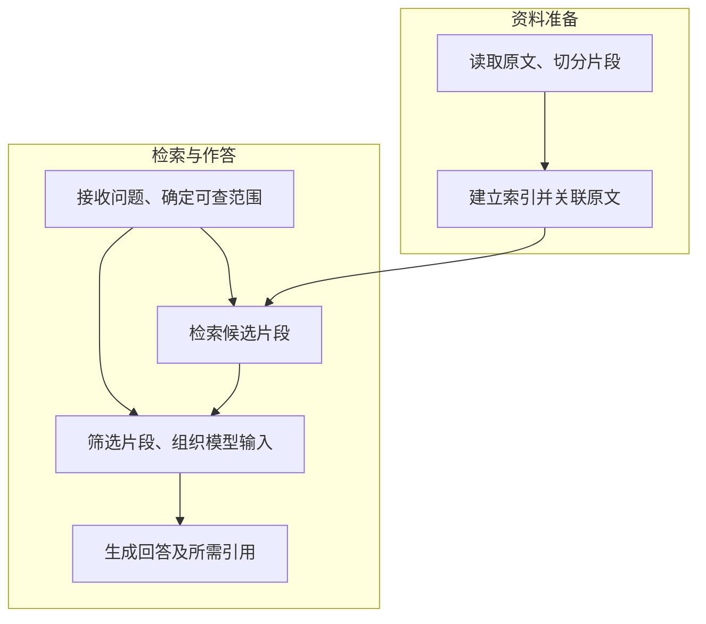

---
aliases:
  - 检索增强生成
  - Retrieval-Augmented Generation
---

# 检索增强生成（RAG）

## 概念

### 定义

<!-- 提示
**备选问题**：它是什么？
[第一性原理](thinking-principles.md)
优先借鉴wiki。
-->

**检索增强生成（Retrieval-Augmented Generation，RAG）** 是一种生成方法。系统根据当前问题从外部知识源查找资料，生成模型再利用查到的内容组织回答。==判断是否用了 RAG，要看本次检索取得的资料是否参与了生成。== 关键词和向量都可以用来检索。原始论文用可检索的外部记忆补充模型参数中的知识，文档问答系统常把选中的原文片段放进模型输入。[Lewis 等，RAG 原始论文](https://arxiv.org/abs/2005.11401) · [Anthropic，RAG 基本流程](https://www.anthropic.com/research/contextual-retrieval)

### 核心价值

<!-- 提示
**备选问题**：它针对的问题有哪些？问题难点在哪里？根因有哪些？提供了什么价值？
分析时，从问题的具体表现溯因推理，总结「特征/根因」。
成文时，首句直接点明它解决或缓解了什么具体问题，再说明问题为何产生、方法如何起效。
首句推荐示例：“LLM 的知识截止到训练时「特征/根因」，难以回答依赖新知识的请求「问题」，RAG 让 LLM 能查到最新资料「价值」。”
[矛盾论](thinking-principles.md)
-->

**补充最新知识和业务知识。** 模型在训练中学到的知识不会自动更新，也难以覆盖组织内部的资料。RAG 在作答时检索相关内容，让模型能够回答依赖新知识或内部资料的问题。资料量大时，系统可以按问题选取片段，使超出单次输入容量的知识库也能用于问答。[Google Cloud，为什么使用 RAG](https://cloud.google.com/use-cases/retrieval-augmented-generation)

**减少缺乏依据的回答。** 模型即使缺少所需事实，也可能生成听起来合理的答案。RAG 将相关原文交给模型，为作答补充事实依据，有助于减少错误。效果取决于资料是否可靠、检索是否准确，以及模型是否正确使用了资料。[Google Cloud，事实依据与回答质量](https://cloud.google.com/use-cases/retrieval-augmented-generation)

**提供核验依据。** 回答没有出处，读者就难以判断结论是否符合原文。RAG 系统可以保留检索片段的来源，并在回答中附上对应引用，方便读者检查结论是否成立、有没有遗漏适用条件。[Gao 等，引用质量评估](https://aclanthology.org/2023.emnlp-main.398/)

**便于更新知识和控制来源。** 通过训练修改模型知识需要额外成本，也难以直接追查某条回答用了哪些资料。RAG 将可检索的知识保存在外部，应用可以通过更新文档和索引维护知识，选择可信来源，并按用户权限限定检索范围。[AWS，成本与开发者控制](https://aws.amazon.com/what-is/retrieval-augmented-generation/)

### 相似概念

<!-- 提示
**备选问题**：有哪些容易混淆的概念？如何区分？
推荐表格比较异同，无混淆概念skip。
按需定义对比字段，优先考虑候选字段。
候选字段：名称<必有>、说明<必有；一句话>、挑战<应对的问题>、核心机制、优点<必有>、缺点<必有>、场景<必有>、使用条件、代价、热度<star/热度>
-->

| 名称                 | 说明                   | 优点                    | 缺点                          | 场景                          |
| ------------------ | -------------------- | --------------------- | --------------------------- | --------------------------- |
| 搜索                 | 按查询查找并返回相关资料         | 能直接查看原文，自行核对和选择依据     | 结果仍需阅读、筛选和整合，查询措辞会影响命中      | 查文档、找出处，或为下游程序提供资料          |
| 全文输入               | 把指定资料完整交给模型阅读和作答     | 保留整篇内容，省去检索及其漏选片段的风险  | 受输入容量限制，长文本会增加输入开销，也可能被模型漏读 | 资料范围明确且能完整放入输入，需要通读、总结或综合分析 |
| RAG                | 按问题检索资料，再让模型依据结果生成回答 | 能按需使用大型知识库，并接入更新后的资料  | 可能漏检、选错片段或丢失上下文，还需维护索引      | 面向较大或持续更新的知识库，回答可由相关片段支撑的问题 |
| [[大模型/微调与后训练\|微调]] | 用训练样本调整模型参数，使其适应目标任务 | 合适的样本可改善特定任务、风格或格式的表现 | 需要训练数据和训练成本，学到的知识仍不会自动更新    | 有高质量训练样本，需要稳定改善某类任务表现       |

搜索可以承担 RAG 的检索环节，微调后的模型也可以用于 RAG。原始论文就联合微调了检索器和生成模型。[Lewis 等，第 2 节](https://arxiv.org/html/2005.11401v4#S2)

### Ask

**Ask A01**：一个系统用关键词找到原文，并依据原文生成回答。判断它是否属于 RAG，应看什么？

## 工作原理

<!-- 提示
通常先讲基本过程，再介绍关键组成；理解过程必须先认识结构时，可交换前两节。
图文各自补充信息，避免重复。具体故障与排查放到“问题空间与方案”。
-->

### 基本过程

<!-- 提示
**备选问题**：整个系统完成什么事情？从输入到输出经过哪些环节？各环节做什么、起什么作用，彼此如何衔接？
先概览整体过程，再逐项展开具体步骤；存在多级结构时，按层级分组说明。简单顺序用步骤，复杂交互用流程图。
[系统性思考](thinking-principles.md)
-->

RAG 将外部资料接入问答。文档问答通常先完成资料准备，收到问题后再检索相关内容，并据此生成回答。

#### 资料准备

1. **读取原文、切分片段。** 读取文档内容，按段落、标题或长度切成可单独检索的片段。切分时保留理解内容所需的上下文，并记录文档标识、版本和原文位置，得到可用于建索引的片段及来源信息。[Anthropic，资料切分与上下文](https://www.anthropic.com/research/contextual-retrieval)

2. **建立索引并关联原文。** 根据检索方式，为片段建立关键词或向量索引，并保留索引记录到原文片段的对应关系。这样，下一阶段可以按问题查找片段并取回原文。资料修订时，同步更新片段和索引，并确认变更已生效。[Anthropic，索引与检索](https://www.anthropic.com/research/contextual-retrieval) · [OpenAI，向量库文件操作](https://developers.openai.com/api/docs/guides/retrieval#vector-store-file-operations)

#### 检索与作答

1. **接收问题、确定可查范围。** 接收用户问题，根据已认证的用户身份确定其可访问的知识库或文档范围。问题用于查找相关内容，权限范围用于限定可查资料；原始问题也会继续传给生成环节。[阿里云，权限与检索范围](https://help.aliyun.com/zh/mobi/control-knowledge-base-retrieval-scope)

2. **检索候选片段。** 在限定范围内查询索引，通过关键词匹配、向量相似度或两者结合取得可能相关的片段。返回结果包括片段内容、相关性分数和出处。这批初步结果称为**候选片段**，供下一步筛选。[阿里云，检索流程与返回结果](https://help.aliyun.com/zh/model-studio/rag-knowledge-retrieval)

3. **筛选片段、组织模型输入。** 按需对候选片段去重和重排，在模型输入容量内选取有助于作答的内容。将选中的片段与原始问题、作答要求和出处一起组织成输入，交给生成模型。这一轮实际提供给模型的全部信息称为**上下文**。[Anthropic，片段选择与重排](https://www.anthropic.com/research/contextual-retrieval)

4. **生成回答及所需引用。** 模型读取上下文，围绕问题整理并生成答案。需要引用时，利用片段携带的来源信息，将相关结论关联到具体文档和原文位置，使读者能够回查依据。[Lewis 等，第 2 节](https://arxiv.org/html/2005.11401v4#S2) · [Claude 文档，引用位置](https://platform.claude.com/docs/en/build-with-claude/citations#citation-indices)

### 关键组成

<!-- 提示
**备选问题**：有哪些关键要素？各自是什么、负责什么？它们如何组成系统，彼此如何依赖？需要哪些外部资源？
围绕主题识别关键要素，逐项介绍其名称、是什么、作用，各项的联系，按需补充有助理解的内容。
按信息关系选择列表、表格或分段，结构与依赖关系按需配图。
[系统性思考](thinking-principles.md)
-->

以下按职责划分组成，各项可以由同一工具或服务实现。

| 名称 | 是什么 | 作用及联系 |
| --- | --- | --- |
| 知识源 | 保存原文的文档库、数据库或网站 | 提供资料与出处，接入时需要具备相应读取权限 |
| 索引 | 用于定位原文的数据结构 | 保存词项或向量与片段的对应关系，供检索器快速查询 |
| 嵌入模型 | 将文本编码为数值向量的模型 | 在向量检索中，为文档片段和查询提供可比较的表示 |
| 检索器 | 按查询寻找相关内容的组件 | 使用索引和查询条件，返回候选片段及来源信息 |
| 上下文构建模块 | 筛选资料并组织模型输入的程序逻辑 | 连接检索器与生成模型，决定实际送入模型的内容 |
| 生成模型 | 理解输入并生成文字的语言模型 | 接收组织好的上下文，生成答案及所需引用 |

嵌入模型服务于向量检索，生成模型服务于回答生成，二者承担不同职责。外部搜索服务可以提供索引与检索能力，模型也可通过外部服务调用。系统实际需要接入哪些服务，取决于哪些能力由自己实现。[Anthropic，RAG 基本流程](https://www.anthropic.com/research/contextual-retrieval) · [Lewis 等，第 2.2—2.3 节](https://arxiv.org/html/2005.11401v4#S2.SS2)

### 关键要素

<!-- 提示
**备选问题**：背后的核心原理是什么？关键要素（技术/原理/论文...）是什么？
围绕理解主题所需的关键点展开，按需介绍相关技术、论文或底层思想，说明它们如何解释或支撑该主题。
[第一性原理](thinking-principles.md)
[求证](thinking-principles.md)
没有不硬凑。
涉及论文提出的机制时，引用原文中解释该机制的段落或公式。
-->

**文本表示与相关性匹配。** 关键词检索通过共同词项寻找线索，向量检索则把文本表示为可比较的数值向量。向量的匹配能力来自模型训练。稠密段落检索（Dense Passage Retrieval，DPR）分别编码问题和段落，用相关与不相关的问答材料训练编码器，使相关段落获得更高的相似度分数。文档向量可以预先计算，因此收到问题后，只需编码查询并搜索索引。该机制支持寻找措辞不同但含义相关的资料。[DPR 论文，第 3.1—3.2 节](https://aclanthology.org/2020.emnlp-main.550.pdf#page=2)

**参数知识与外部记忆结合。** 模型在训练中把知识编码进参数，这部分称为参数化知识；可检索的文档则提供可直接更新的外部记忆。RAG 原始论文将检索器选择文档的概率，与模型依据问题和文档生成答案的概率联合建模。它说明了检索与生成如何共同决定回答，也通过更换资料索引验证了知识更新。常见文档问答系统将选中的原文放进模型输入，使这些内容在本次作答中参与生成。[Lewis 等，第 2.1 节](https://arxiv.org/html/2005.11401v4#S2.SS1) · [第 4.5 节](https://arxiv.org/html/2005.11401v4#S4.SS5) · [Anthropic，RAG 基本流程](https://www.anthropic.com/research/contextual-retrieval)

**以证据支持具体结论。** 相似度衡量片段与问题的匹配程度，判断结论是否成立还需要核对证据。一个结论可能同时依赖正文、时间范围和其他段落中的例外条款。可以将回答拆成事实主张，逐项检查所给资料能否支持。发现证据缺口时，围绕缺失信息继续检索；对于要求依据资料作答的任务，仍缺依据的部分应说明无法确定。[Ragas，忠实度](https://docs.ragas.io/en/stable/concepts/metrics/available_metrics/faithfulness/) · [Jiang 等，主动检索](https://aclanthology.org/2023.emnlp-main.495/) · [RAG-RewardBench，资料不足时的作答](https://aclanthology.org/2025.findings-acl.877.pdf)

### Ask

**Ask A02**：原文已经修订，回答却仍引用旧条款。你会沿着哪条数据路径追查旧内容的来源？

## 分类

<!-- 提示
**备选问题**：有哪些常用分类维度？为什么这样分？各维度下有哪些类型？类型之间有哪些重要差异与联系？
明确分类对象，选择有助于理解主题的分类维度，说明划分依据并介绍主要类型。
多个类型用列表或表格展示，先讲核心特点，突出差异；按需补充新机制、特点或适用条件，避免重复前文。
[系统性思考](thinking-principles.md)
-->

RAG 可以按整体设计、检索轮次和匹配方式分类，分别帮助理解流程如何组织、何时继续查找、怎样匹配资料。

**按整体设计分类**

Gao 等综述归纳了三种范式，主要区别在于如何组织和改进处理流程：

| 类型 | 核心特点 |
| --- | --- |
| 基础 RAG（Naive RAG） | 沿着建立索引、检索资料、生成回答的基本流程运行 |
| 增强 RAG（Advanced RAG） | 在基本流程中加入查询改写、重排、上下文压缩等优化，提高资料检索与利用质量 |
| 模块化 RAG（Modular RAG） | 按任务组合处理模块，例如选择资料来源、切换检索路径或重复检索，形成可调整的流程 |

三者存在继承与重叠：模块化 RAG 也可以采用增强 RAG 中的优化方法。这是理解系统设计的一种分法，名称本身不代表效果高低。[Gao 等，综述第 II 节](https://arxiv.org/html/2312.10997v5#S2)

**按检索轮次分类**

- **单轮检索**：取得一批资料后生成回答，适合一次就能找齐依据的问题。
- **多轮检索**：根据中间结果继续查找，逐步补齐依据，适合后续查询需要依赖已有结果的任务，但会增加调用和等待时间。[Jiang 等，主动检索](https://aclanthology.org/2023.emnlp-main.495/)

**按匹配方式分类**

这一维度细分的是 RAG 的检索环节，区别在于用什么线索寻找资料：

- **关键词检索**：靠词项匹配，适合编号、名称等明确线索。
- **向量检索**：靠向量相似度，帮助找到措辞不同但含义相关的资料。
- **混合检索**：结合关键词与向量检索的候选结果，兼顾明确线索和不同措辞。[Anthropic，关键词与向量检索](https://www.anthropic.com/research/contextual-retrieval)

若编号必须精确匹配，仍需筛选或核对原文。[OpenAI，按属性筛选](https://developers.openai.com/api/docs/guides/retrieval#attribute-filtering)

不同维度可以组合：一个模块化 RAG 系统可以采用混合检索，并根据需要进行多轮查询。

### Ask

**Ask A03**：问题中既有必须精确匹配的编号，又有与原文不同的措辞。你会怎样选择检索方法？

## 问题空间与方案

<!-- 提示
围绕目标与约束，按“问题 → 成因 → 方案 → 机制 → 代价 → 选择条件”分析。
-->

RAG 要在有限的输入容量、时间和费用内，把足够且适用的资料交给模型，并让模型正确使用。困难集中在三个环节：切分时保住语境，检索时找齐依据，生成时用对依据。

### 矛盾与瓶颈

<!-- 提示
**备选问题**：
- 矛盾：哪些目标或要求相互制约？为什么这组矛盾最重要？
- 瓶颈：当前瓶颈是什么？目前的解决方案是什么？

[矛盾论](thinking-principles.md)
判断瓶颈时，核对适用条件和证据（[求证](thinking-principles.md)）。
-->

- **片段聚焦与语境完整。** 切分便于按需检索，却可能把正文与标题、指代对象、适用条件分开；扩大片段能保留更多语境，也可能混入无关内容。片段长度需要结合文档结构和问题选择，不能认定越短越好。[Anthropic，切分造成的语境缺失](https://www.anthropic.com/research/contextual-retrieval)
- **证据覆盖与处理开销。** 找到的候选越多，越有机会补齐依据，也越需要筛选。把更多内容直接交给模型，还会增加输入量和干扰。因此，可供筛选的候选数量与最终输入数量，需要分别控制。[阿里云，检索与排序配置](https://help.aliyun.com/zh/model-studio/rag-knowledge-retrieval) · [Liu 等，第 5 节](https://arxiv.org/html/2307.03172v3#S5)
- **资料可见与正确利用。** 证据已经进入上下文，模型仍可能漏读条件或错误整合。长上下文研究发现，在所测模型与任务中，证据位置也会影响回答质量。因此，检索改善后，瓶颈可能转移到模型对资料的理解和使用。[Liu 等，第 2.3 节](https://arxiv.org/html/2307.03172v3#S2.SS3)

### 解决方案

<!-- 提示
**备选问题**：解决同一问题有哪些不同思路？各方案如何起效？在相同目标与约束下，效果和代价有何差异？
[矛盾演化](thinking-principles.md)
说明限制是被消除、减轻，还是转移到了其他环节。
-->

**保住语境：扩大原文范围，或补充片段说明。**

- **保留更完整的原文段落**：适合正文依赖相邻条件的资料，代价是输入变长，可能带入更多无关内容。
- **为片段补充语境说明**：在建索引前注明所属主题、对象等信息，帮助片段被正确检索。它增加预处理开销；若说明由模型生成，还要核对是否忠于原文。[Anthropic，上下文检索及其成本](https://www.anthropic.com/research/contextual-retrieval)

两种方法缓解的是切分造成的信息缺失，无法补出源文档本来就没有的依据。

**减少漏检与干扰：扩大候选，再筛选输入。**

| 做法 | 如何起效 | 选择条件与代价 |
| --- | --- | --- |
| 调整查询、结合关键词与向量检索 | 从不同匹配线索找回候选，减少单一路径的遗漏 | 适合原文有依据却没有被找到的情况；增加查询和结果合并开销 |
| 扩大候选范围，再重排筛选 | 先保留更多可能相关的片段，再优先选取能回答问题的内容 | 适合较大候选集中已包含必要依据的情况；重排增加耗时与费用，也可能误筛必要片段 |

这类方案把部分压力从模型阅读转移到检索和筛选环节。重排只能处理已有候选，未被检索到的依据仍需补查。[阿里云，检索流程](https://help.aliyun.com/zh/model-studio/rag-knowledge-retrieval) · [Anthropic，重排与开销](https://www.anthropic.com/research/contextual-retrieval)

**减少误用：组织证据，核对结论。**

当依据已经找齐，可去掉无关重复内容，把结论依赖的条件一起提供给模型，并核对回答是否保留了这些条件。需要引用时，让结论对应到原文，便于发现缺少支持或引用不符之处。整理与核验增加了处理成本，引用本身也不保证答案正确。[Liu 等，第 2.3 节](https://arxiv.org/html/2307.03172v3#S2.SS3) · [Gao 等，回答正确性与引用质量](https://aclanthology.org/2023.emnlp-main.398/)

选择方案前，先沿同一次回答检查依据在哪一步丢失：

1. **原文有，候选没有**：检查切分、索引、检索范围与匹配方式。
2. **候选有，模型输入没有**：检查筛选、重排和长度截断。
3. **模型输入有，回答未正确使用**：检查证据组织、作答要求与模型理解。

如果原文就缺少或不适用，应先处理资料问题。不能用增加检索数量来替代缺失的知识。上述分法用于定位优先检查的环节，具体改进效果仍需验证。[阿里云，检索结果与来源](https://help.aliyun.com/zh/model-studio/rag-knowledge-retrieval) · [Liu 等，第 5 节](https://arxiv.org/html/2307.03172v3#S5)

### Ask

**Ask A04**：条款正文排在首位，回答却遗漏了例外条件。怎样查明例外条件是在检索、组装输入还是生成时被遗漏的？

> [!faq]- 答案
> 先确认当前适用的原文确实包含例外条件，再对照同一次请求的候选片段、模型实际输入和回答。候选没有例外条件，检查切分与检索；候选有而输入没有，检查筛选或截断；输入已包含却未体现在回答中，检查模型对条件的理解和使用。正文排在首位只说明它排名靠前，不能证明例外条件也已进入模型输入。

## 使用场景

<!-- 提示
**备选问题**：哪些任务适合用它？什么情况下更适合其他方案？
-->

当资料频繁修订、每个问题只涉及一小部分内容、不同用户能看的资料不同，或回答需要逐条核验时，RAG 值得考虑。它的收益取决于知识库能按时更新、检索能遵守权限、片段能追溯到原文。[Lewis 等，知识更新与出处](https://arxiv.org/abs/2005.11401) · [阿里云，按用户限定可查资料](https://help.aliyun.com/zh/mobi/control-knowledge-base-retrieval-scope)

若授权资料短且范围固定，可以先用全文输入建立比较基准。在同一组代表性问题上比较全文和检索两种输入的正确率、证据支持程度、费用与耗时。全文能减少漏选证据的机会；检索可能减少输入量和无关信息。哪项收益更大，取决于资料规模和模型在该任务上利用长文本的能力。[Anthropic，直接使用较长提示词](https://www.anthropic.com/research/contextual-retrieval) · [Liu 等，长上下文的利用](https://aclanthology.org/2024.tacl-1.9/)

## 评估方法

### 目标与指标

<!-- 提示
**备选问题**：要评估哪方面的表现？用什么指标衡量？怎样算达标？
说明指标口径和单位。用过程指标推断最终效果时，指出可能的误判。
梳理变量及其关系，识别潜在杠杆点。关系可量化时，用公式表达。
[数学建模](thinking-principles.md)
-->

**检索看证据找回了多少。** 固定返回数量 $k$，在有参考证据的题目上计算前 $k$ 项命中率，即至少找回一条参考证据的题数除以总题数。对于需要多条证据的题，还要计算每题的证据覆盖率，再取题目平均。先约定按事实还是片段计数，重复命中同一项只计一次。若多组证据都能独立作答，应接受任一完整组合。[Ragas，按标识计算召回率](https://docs.ragas.io/en/stable/concepts/metrics/available_metrics/context_recall/#id-basedcontext-recall) · [KILT，检索评估](https://aclanthology.org/2021.naacl-main.200.pdf#page=7)

$$
\text{单题证据覆盖率} =
\frac{\text{前 }k\text{ 项中找回的必要证据数}}{\text{该题所需的证据数}}
$$

**回答看结论和依据。** 正确性依据题目要求与可信参考答案判断；忠实度衡量回答中能由实际输入资料支持的事实主张比例。模型忠实复述旧版文件，仍可能答错当前规则。若还要求引用，应逐项检查被引原文是否支持对应主张。对要求仅据资料回答的任务，资料不足题统计无依据作答率，可回答题统计误拒率，两者分别以各自题数为分母。[Ragas，忠实度](https://docs.ragas.io/en/stable/concepts/metrics/available_metrics/faithfulness/) · [Gao 等，引用质量](https://aclanthology.org/2023.emnlp-main.398/) · [RAG-RewardBench，恰当拒答](https://aclanthology.org/2025.findings-acl.877.pdf)

**代价按一次完整问答计。** 统计从收到问题到交付完整回答的耗时，以及检索、重排和生成的费用，统一用秒/题和元/题等单位。运行费用和建库费用分开记录；比较前先约定可接受的质量、延迟和成本范围。[Anthropic，重排的成本与耗时](https://www.anthropic.com/research/contextual-retrieval)

### 验证方法

<!-- 提示
**备选问题**：用什么数据或测试验证？比较方案时，以什么为基线？
检验某个因素的影响时，说明对照条件。
[求证](thinking-principles.md)
-->

建立测试集时固定资料版本和用户权限。对可回答题，标注参考答案、必要证据及可替代的出处；对资料不足题，标注缺失的信息与预期作答范围。这样能把“资料里没有”与“资料里有却没找到”分开计量。[KILT，证据标注与评估](https://aclanthology.org/2021.naacl-main.200.pdf#page=7) · [RAG-RewardBench，资料不足的标注](https://aclanthology.org/2025.findings-acl.877.pdf)

在可回答题上固定问题、模型、作答要求与评分规则，只改变提供的资料。三组对照借鉴了长上下文问答研究中的闭卷和给定正确文档实验。[Liu 等，第 2.3 节](https://arxiv.org/html/2307.03172v3#S2.SS3)

| 对照组 | 供给模型的资料 | 结果怎样解读 |
| --- | --- | --- |
| 无资料 | 仅给问题 | 得到无外部资料时的基准分；若任务要求有据才答，记录模型是否按要求拒答 |
| 实际检索 | 使用系统实际选取和排列的片段 | 与无资料组逐题比较，观察加入整套检索流程后，正确性和作答行为如何变化 |
| 人工证据 | 给出经核实、足以作答的原文组合 | 人工组答对、实际组答错，优先检查漏检、截断及干扰文字；人工组仍错，则复核题意、标注和模型对证据的利用 |

人工组可能同时改善证据完整性、排列位置和输入长度。要进一步定位原因，可保持实际输入不变，只补入缺失条款；或固定内容，只调整片段顺序。比较同一题的回答是否随这一项变化，能缩小需要排查的范围。[Liu 等，证据位置实验](https://arxiv.org/html/2307.03172v3#S2.SS3)

### Ask

**Ask A05**：更换检索方法后，更多问题命中了证据，答案正确率却没提高。怎样用人工选定的完整证据检验瓶颈是否仍在检索环节？
