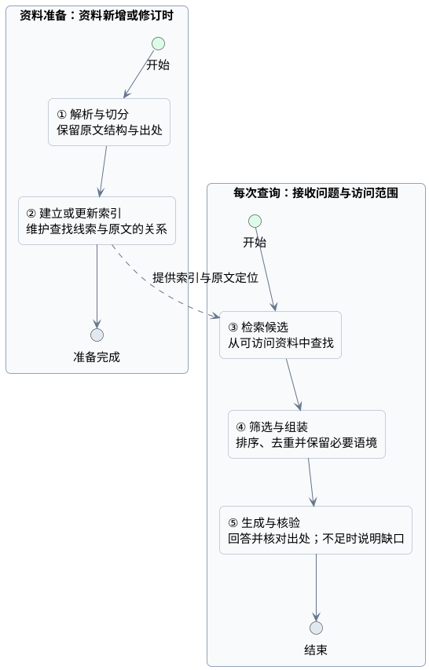

# 检索增强生成（RAG）

## 概念

### 定义

**检索增强生成（Retrieval-Augmented Generation，RAG）**是一种让生成模型按当前任务查用外部资料的方法：先检索相关内容，再让检索结果参与回答的生成。外部资料保存在可更新的知识源中，不必全部记入模型参数。[Lewis 等，§2](https://arxiv.org/html/2005.11401v4#S2)

RAG 的关键是检索与生成之间的依赖关系，不是是否使用向量数据库。关键词搜索也能提供生成依据；只列出搜索结果，尚未完成增强生成；生成之后补找链接，也不能证明原回答受到了证据约束。

### 核心价值

RAG 使[[LLM|LLM]]能够利用训练时未覆盖的内部资料与后续更新。它把一部分知识维护工作转移到外部知识源：修订原文，并让检索系统读到新版本，就有机会改变回答依据。[Lewis 等，§4.5 的索引替换实验](https://arxiv.org/html/2005.11401v4#S4.SS5)

RAG 还为核验提供了入口。**可追溯**是能找到结论所用的原文；**有依据**是原文确实支持结论；**正确**还要求原文本身可信、适用于当前问题。这三个条件需要分别检查，附有链接并不等于回答正确。

知识源错误、漏检、误读都可能传播到回答。因此，RAG 缓解的是知识获取与证据使用问题，不能自动消除模型编造、推理错误或资料冲突。

### 相似概念

| 名称 | 说明与优点 | 局限与适用条件 |
| --- | --- | --- |
| 搜索 | 返回文档或片段，便于直接定位原文 | 适合找资料；跨资料综合仍由读者承担 |
| 全文输入 | 将指定材料直接交给模型，避免检索选材时遗漏 | 适合材料范围明确且输入容得下的任务；模型仍可能读漏 |
| RAG | 按任务选取外部内容，降低每次阅读的资料量 | 适合资料多而单题所需范围较小的任务；选材失误会影响回答 |
| 微调 | 用训练数据调整参数，改变任务行为和输出习惯 | 适合有代表性训练样本的稳定任务；知识更新仍需维护 |

RAG 与[[大模型/微调与后训练|微调]]可以组合：一者提供本次作答的资料，另一者改进模型处理资料的能力。原始 RAG 研究共同训练了将问题转换为检索向量的查询编码器，以及负责组织回答的生成器，同时保留外部文档索引。[Lewis 等，§2.4](https://arxiv.org/html/2005.11401v4#S2.SS4)

> [!faq]- A001：判断一个系统是否属于 RAG，关键条件是什么？
> 系统按当前任务检索外部内容，并让这些内容参与回答生成。检索方式可以不同；向量数据库、引用链接和正确答案都不是单独足以判断的条件。

> [!faq]- A002：RAG 与微调为什么可以同时使用？
> RAG 改变本次回答可用的外部信息，微调改变模型参数与任务行为。需要不断更新事实、同时提高资料理解或回答规范性时，可以同时采用，两者分别承担信息供给和能力调整。

## 工作原理

### 基本过程

理解流程时，先分开**资料准备**和**每次查询**。索引是一种支持快速查找的结构，把检索线索映射到原文位置。上下文是本次生成实际接收到的材料。

1. **解析与切分**：把原文转为可处理的内容，按段落或结构切成检索单元，保留出处、标题、时间和权限等信息。
2. **建立或更新索引**：记录词项、向量或其他查找线索与原文的关系。原文变化后，同步更新相应索引和失效内容。
3. **检索候选**：根据问题和用户可访问范围，查找可能有用的片段。候选只是待检查的材料，并不自动构成答案依据。
4. **筛选与组装**：重新排序、去重，保留必要上下文，在输入容量内组织资料。这里的取舍决定模型最终能看到什么。
5. **生成与核验**：依据材料组织回答，并检查结论与出处的对应关系。证据不足时说明缺口；是否继续检索由任务预算和系统设计决定。

教材给出的基本 RAG 路径是检索、组装输入、生成回答。[《大语言模型》官方 RAG 课件，第 3–5 页](https://github.com/LLMBook-zh/LLMBook-zh.github.io/blob/main/slides/%E7%AC%AC%E4%B8%83%E8%AF%BE%20%E6%8F%90%E7%A4%BA%E5%AD%A6%E4%B9%A0/7.4%20%E6%A3%80%E7%B4%A2%E5%A2%9E%E5%BC%BA%E7%94%9F%E6%88%90.pdf)

上述版本、权限和核验要求是本文据此提出的工程检查点。若系统支持多轮检索，应另外规定停止条件：证据已充分、没有新信息，或到达轮数、时间、费用上限。到达上限不代表证据已经充分。

### 关键组成

| 名称 | 职责与输入输出 | 检查重点 |
| --- | --- | --- |
| 知识源与解析器 | 将文档转换为保留结构的内容 | 原文可靠性、解析遗漏、版本与权限 |
| 索引与检索器 | 将问题转换为查找线索，返回候选原文 | 必要信息是否可查、是否被漏检 |
| 重排与上下文组装器 | 对候选重新排序，形成生成输入 | 证据是否被删去、截断或混入冲突版本 |
| 生成器 | 将问题与材料转换为回答 | 是否误读条件、遗漏要点或添加无依据结论 |
| 核验与观测组件 | 保存过程记录，对照证据检查回答 | 能否定位失败环节与重现结果 |

这些组件是职责划分，不要求各自部署成独立服务。外部资源至少包括知识源、生成模型，以及与所选检索方式匹配的搜索能力。

### 能力模型

以下是本文为诊断而定义的模型，不是某篇论文的性能定律。先限定任务：**必须依靠本次提供的证据作答**，仅凭模型记忆答对不计为证据链成功。

本模型针对检索结束后统一生成最终答案的流程。固定一组非空测试问题及资料、权限和时间范围，记问题数为 $N>0$。逐层统计：

- $N_K$：知识源中存在可访问、适用且足够回答的证据的问题数。
- $N_R$：在上述问题中，候选集合已包含充分证据的问题数。
- $N_C$：在上述问题中，最终生成输入仍保留充分证据的问题数。
- $N_S$：在上述问题中，回答正确、完整且关键结论获得证据支持的问题数。

各层集合相互包含。定义**证据链成功率** $Y=N_S/N$，按流程逐步拆解：

$$
\begin{aligned}
Y &= \frac{N_S}{N} \\
  &= \frac{N_K}{N}\times\frac{N_S}{N_K} \\
  &= \frac{N_K}{N}\times\frac{N_R}{N_K}\times\frac{N_S}{N_R} \\
  &= \underbrace{\frac{N_K}{N}}_{\text{知识覆盖率}\uparrow}\times
     \underbrace{\frac{N_R}{N_K}}_{\text{候选充分率}\uparrow}\times
     \underbrace{\frac{N_C}{N_R}}_{\text{输入保留率}\uparrow}\times
     \underbrace{\frac{N_S}{N_C}}_{\text{有据作答率}\uparrow}
\end{aligned}
$$

这是计数相消得到的恒等式，不假设各环节独立。箭头只表示**其他因子不变时**的改善方向。分母为零时，相应条件率未定义，应报告该层无样本；若没有任何成功问题，则整体 $Y=0$。

**充分证据**要求所需信息能联合支持完整回答，不能只检查是否出现一段相关文字。若生成前进行了多轮检索，应把各轮结果计入完整候选集合。若检索与分段生成交替进行，需另定义各次生成实际可用的证据及其依赖，不能直接套用这条单次生成漏斗。对于允许使用模型记忆、允许无资料拒答的综合任务，应另报整体任务成功率，不能用 $Y$ 替代。

优化时把因子对应到动作：知识缺失先补源，候选缺证据再改检索，输入丢证据再改筛选，证据齐全仍答错才检查生成。判断优先级还要看首次失败题数、可修复比例及成本；条件率低本身不足以证明最值得投入。

### 关键机制

**检索：把问题与原文变成可比较的信号。** 词项检索重视字面匹配；稠密检索将文本编码为连续数值向量，利用向量相近程度寻找语义相关材料。双编码器分别编码问题和原文，原文向量可预先计算；交叉编码器共同读取问题与原文，更适合在少量候选上精细判断。[《Speech and Language Processing》，§11.3](https://web.stanford.edu/~jurafsky/slp3/11.pdf#page=13)

**混合检索：合并不同信号的候选。** BM25（Best Matching 25）是依据词频、词项稀有程度和文档长度评分的方法。将它与稠密检索的结果融合，可同时利用字面与语义线索。Anthropic 的 Contextual Retrieval 方案包含这种组合，并在建索引前为片段添加原文语境。[Anthropic，传统 RAG 与 Contextual Retrieval](https://www.anthropic.com/research/contextual-retrieval)

实际选择时，应检查各路检索是否找到了对方遗漏的必要证据，再评估融合收益。原始分数未必同量纲，不能未经校准直接相加。增加一路检索也会增加延迟、存储或维护负担。

**重排：把有限阅读容量分给更有用的候选。** 重排是在候选集合内部重新排序；单纯重排无法找回从未入选的原文。先扩大候选覆盖，再精筛进入生成输入的内容，是将搜索范围与阅读成本分开的思路。

**切分与组装：保留意义，同时控制噪声。** 小片段定位更细，但可能切断主语、限定条件或跨段关系；大片段保留更多语境，也会占用输入容量。应按结构边界切分，追踪标题和相邻内容；不存在适用于所有资料的固定最佳长度。

**证据使用：相关不等于支持。** 生成器需要判断材料是否共同支撑结论、是否存在冲突，并保留适用条件。长输入也不是可靠阅读的保证：《Lost in the Middle》在所测模型和任务中发现，证据所在位置会影响表现。[论文摘要](https://arxiv.org/abs/2307.03172)

据此，部署前应对所用模型测试输入长度、材料顺序和干扰片段，而不能把早期模型的实验结果直接当成所有模型的固定规律。

> [!faq]- A003：为什么资料更新后，回答仍可能没有更新？
> 原文更新只是起点。解析结果、索引、候选选择和最终输入之间还存在传递过程；任一环节仍保留旧内容，生成器就可能读到旧证据。因此要核对资料准备路径与查询路径是否接通。

> [!faq]- A004：证据链成功率为什么要使用逐层条件率？
> 因为每个因子的分母都是上一层通过的问题数，相乘后中间计数相消，得到成功问题数占全部问题数的比例。这不要求环节独立。到达后层的样本少不意味着该层通过率低；分母为零时不能硬算条件率。

> [!faq]- A005：检索与重排分别解决什么问题？
> 检索决定哪些原文进入候选集合，重排决定候选的优先顺序。必要证据根本没入选时，应检查知识覆盖和检索；已入选却排后或被挤出生成输入时，才主要检查排序与组装。

## 分类

下表按三个不同维度分类。各维度可以组合，不能把所有类型排成一条由低到高的等级。

| 分类维度 | 类型及工作方式 | 适用条件与主要代价 |
| --- | --- | --- |
| 检索信号 | 词项检索、稠密检索、混合检索 | 分别侧重字面、语义及互补覆盖；混合方案增加调参与维护 |
| 资料组织 | 原文片段、层次摘要、实体关系图 | 分别便于局部取证、跨层概括和关系组织；摘要与图结构需要额外构建并核对原文 |
| 查询控制 | 单轮检索、多轮检索、自适应检索 | 单轮流程简单；多轮补足依赖信息；自适应决定是否继续查，增加判断错误和预算失控的可能 |

**实体关系图**把资料中的对象及其联系组织成图。它提供额外的检索线索，本身不保证关系抽取正确。**自适应检索**则依据当前问题或生成状态调整检索行为，是否有效取决于判断机制的质量。

这些分类用于定位设计选择：先明确缺的是匹配能力、资料组织还是查询控制，再决定增加哪种结构。新结构需要证明净收益，复杂度本身不是能力指标。

> [!faq]- A006：选择 RAG 类型时，为什么应先明确分类维度？
> 因为检索信号、资料组织和查询控制解决不同问题，也可以同时存在。先定位失败原因，才能判断应改词项与语义匹配、原文组织方式，还是检索轮次；否则容易用复杂流程掩盖基础资料缺失。

## 演进与瓶颈

### 关键演进

RAG 的演进体现了瓶颈的转移：先让生成接入外部资料，再解决查多少、怎么组织和如何判断资料是否可用。以下是代表性路线，不是互相替代的版本序列。

- **可训练的检索与生成结合（2020）**：原始 RAG 将文档视为隐变量，即不直接标注该选哪篇、而在候选文档之间进行推断的中间变量；联合优化查询编码器和生成器，使检索选择与生成任务联系起来。[Lewis 等，§2](https://arxiv.org/html/2005.11401v4#S2)
- **按需检索与自我评议（2023）**：Self-RAG 训练模型生成检索和反思标记，用于控制检索及评议相关性、支持性和回答质量。这是需要特定训练的机制，不能等同于给任意模型加一句“自我检查”。[Self-RAG，§3](https://arxiv.org/html/2310.11511v1#S3)
- **面向整体问题组织资料（2024）**：GraphRAG 从原文构建实体图，把联系紧密的一组实体划为社区，再生成社区摘要，用来回答面向整个语料的问题。它主要处理全局综合需求，并不证明图方法在所有局部问答上都更好。[GraphRAG，v1 §2](https://arxiv.org/html/2404.16130v1#S2)
- **为片段补回语境（2024）**：Contextual Retrieval 在片段索引中加入解释其所在语境的文字，缓解切分后含义不完整的问题。[Anthropic，Introducing Contextual Retrieval](https://www.anthropic.com/research/contextual-retrieval)

工程上使用生成的摘要、关系或语境说明时，应保留回查原文的路径。新增的派生内容可能出错，不能把它与原始证据混为一谈。

### 当前瓶颈

| 瓶颈 | 根因与干预方向 | 代价及验证方式 |
| --- | --- | --- |
| 资料缺失或过期 | 正确证据不存在，或更新链路未完成；补源并处理索引与缓存失效 | 增加维护工作；按生效时间回放问题，核对每层版本 |
| 候选不充分 | 匹配失误，或问题需要多处证据；调整检索、拆分问题或扩大候选 | 增加检索量与噪声；检查完整证据集合是否入选 |
| 输入丢失证据 | 排序、去重、压缩或截断丢掉必要条件；保留结构和原文联系 | 增加输入成本；对照候选与最终输入逐项检查 |
| 生成误用证据 | 误读条件、混用冲突版本、补写无据结论；改回答约束并逐项核验 | 增加时延或拒答；分别测正确性、证据支持和完成度 |
| 多轮查找无收益 | 查询漂移、重复查找、停止判断不可靠；限制预算并识别新增信息 | 可能提前结束；比较新增成功题与额外成本 |
| 权限与内容边界失守 | 可检索不代表可向该用户展示；资料内指令也可能干扰生成 | 权限由可信程序执行；核查跨权限访问和恶意资料输入 |

这张表是依据流程模型整理的诊断建议，不代表每项方案都已有普适收益。尤其是访问控制，应覆盖检索、派生摘要、缓存及输出环节；不能只在回答末尾要求模型隐藏内容。资料中的指令应作为待分析内容处理，不能因此获得系统权限。

排查过期回答时，按**原文 → 解析片段 → 索引 → 候选 → 生成输入 → 回答**核对版本。若输入已经正确，继续重建索引通常无助于解决生成误读；若输入仍旧，应先修复首次失真的位置。

> [!faq]- A007：自适应检索与图式资料组织为何不能简单看作单轮 RAG 的升级版？
> 它们应对不同瓶颈：自适应检索调整何时查、是否继续查；图式组织帮助关联和综合分散信息。两者都增加构建或决策成本，只有改善目标任务并控制额外代价时，才构成实际改进。

> [!faq]- A008：如何定位过期回答最先在哪个环节出错？
> 对同一问题按原文、解析片段、索引、候选、生成输入、回答的顺序核对适用版本。找到首次偏离正确版本的位置，再检查该处的更新或选择机制。若最终输入已正确，则转向生成与引用核验。

## 使用场景

当任务同时满足以下条件时，RAG 值得评估：答案依赖可维护的外部资料；资料总量较大而单次所需范围有限；需要综合表达而不只是找文件；能够检查检索与证据使用是否成功。

若材料少且范围明确，全文输入可以成为更简单的基线。若只需定位原文，搜索可能已足够。若任务要求完整遍历、精确聚合或确定计算，应优先考虑结构化查询与程序计算，再让模型解释结果。若关键资料根本不存在，应先解决知识供给；更换检索器不会凭空补出事实。

选择时还要比较更新频率、来源可追溯要求、权限复杂度、响应时间和维护投入。能够接入检索只是可行性条件，整体效果与成本才决定是否值得使用。

> [!faq]- A009：判断一个任务是否值得使用 RAG，应检查哪些条件？
> 检查答案是否依赖可维护的外部资料、资料是否需要按问题筛选、是否需要生成综合回答，以及是否能验证证据链。再与搜索、全文输入和结构化查询比较效果与成本；知识源缺失时优先补源。

## 评估与干预

### 指标与测评

先建立固定题集，给出每题的适用时间、权限、必要答案要点和可接受证据集合。对可回答、资料不足、证据冲突和跨权限问题分组统计，避免把应当拒答的任务当作检索失败。

**召回率**衡量相关材料找回多少，**精确率**衡量返回材料中有多少相关。令 $G$ 为标注的相关单元集合，$R_k$ 为前 $k$ 个返回单元，则 $Recall@k=|G\cap R_k|/|G|$，$Precision@k=|G\cap R_k|/|R_k|$。必须固定单元是文档还是片段；空分母另行约定。基础定义见[《Speech and Language Processing》，§11.2](https://web.stanford.edu/~jurafsky/slp3/11.pdf#page=10)。

| 指标 | 本文测量口径 | 能说明什么、不能说明什么 |
| --- | --- | --- |
| 召回率与精确率 | 对每题标注集合计算，再汇总；报告候选数量与标注范围 | 说明选材情况；标注不完整会扭曲结果，相关也未必足够作答 |
| 候选充分率与输入保留率 | 使用能力模型中的条件分母，人工检查证据是否完整 | 分开定位检索损失与组装损失；不能替代回答测评 |
| 回答正确与完整 | 对照适用版本和必要答案要点判定 | 避免把语言流畅误当准确；需检查错误附加结论 |
| 关键结论支持率 | 有证据支持的关键事实结论数 ÷ 应核验的关键事实结论数 | 识别无依据结论；不能单独证明来源可信 |
| 引用有效率 | 能支持所关联结论的引用数 ÷ 全部引用数 | 识别无关引用；不衡量回答是否遗漏重要内容 |
| 合理拒答与误拒答 | 分别统计不可答题中正确拒答比例、可答题中误拒答比例 | 避免依靠一律拒答获得表面上的低错误率 |
| 证据链成功率与代价 | 固定题集上计算 $Y$；同时报告时延分布、费用和维护成本 | 衡量流程净收益；不能只挑某个过程指标优化 |

表中的“关键结论支持率”和“引用有效率”采用本文便于人工审阅的口径，不等同于论文的全部自动评分规则。ALCE（Automatic LLMs' Citation Evaluation，大语言模型引用自动评估）分别评估回答正确性与引用质量，并检查输出是否被引用段落支持。[ALCE，§3.2–3.3](https://arxiv.org/html/2305.14627v2#S3.SS3)

核验引用时逐项检查：出处能否定位到原文，原文是否支持整条结论，时间和条件是否匹配，多条引用是否共同补足依据。即使引用完全支持回答，也仍需独立评估来源可信度与答案是否完整。

模型评分可辅助初筛，但应抽样人工复核，尤其检查误判、遗漏和不同题型之间的差异。没有人工校准的单一评分，不宜直接作为上线依据。

> [!faq]- A010：检索召回率高，为什么仍可能没有足够证据回答？
> 召回率按标注的相关单元计数，相关单元未必包含所有必要事实或限定条件。多处证据还可能需要联合使用，标注本身也可能不完整。因此要另查候选集合是否足以支持完整回答。

> [!faq]- A011：怎样判断回答中的引用是否有效？
> 先定位原文，再检查其是否支持对应结论的全部含义，包括时间、对象和限定条件；需要联合证据时检查引用是否共同充分。引用支持性、来源可信度和答案完整性是不同检查项，链接能打开只满足定位条件。

### 干预与验证

优先修复证据首次丢失或被误用的位置，并以同一题集上的整体收益验收。

1. **建立基线**：固定题集、知识快照、权限和评分规则，保存候选、生成输入与回答，记录模型、检索配置和预算。
2. **定位损失**：按能力模型记录每题首次失败的环节。首次失败题数分别是 $N-N_K$、$N_K-N_R$、$N_R-N_C$ 和 $N_C-N_S$。
3. **选择干预**：优先处理影响题数多、可修复性高、成本可接受的问题。一次主要改变一个因素；改变多个因素时另做拆分对照。
4. **成对比较**：让同一批问题运行新旧方案，分别统计从失败转成功、从成功转失败的题数，并检查代价变化。波动明显时重复运行，报告不确定性。
5. **复查边界**：检查应拒答、冲突来源和访问权限等分组是否退化；上线后持续记录新问题与资料更新造成的变化。

过程指标上升而整体效果下降时，不能只用“新增问题更难”解释。固定题集与判定标准下，整体成功数下降意味着**原本成功而现在失败的题数，超过原本失败而现在成功的题数**。应查这些回退题是否因新增噪声、截断、顺序变化或生成波动而失败。

条件率则可能因进入该环节的问题集合改变而下降，不能据此直接认定该组件变差。对组件能力的比较，应控制输入集合；对系统是否值得采用的判断，应看同一题集上的整体结果。更多通用测评原则可衔接[[应用/效果评估|效果评估]]。

> [!faq]- A012：固定题集上，检索指标改善而整体成功率下降，应该怎样验证原因？
> 逐题比较新旧结果，确认回退题数是否超过新增成功题数，再检查这些回退题的候选、输入和回答变化。条件通过率下降可能包含样本组成变化，不能单独证明组件退化，也不能单独解释整体成功数减少。

> [!faq]- A013：怎样为 RAG 系统确定下一项最值得做的改进？
> 先固定题集和成功标准，再沿知识源、候选、生成输入、回答记录首次失败位置。结合受影响题数、可修复性和成本选择干预，用同题对照确认新增成功是否超过回退，并检查时延、费用、拒答和权限边界。只有过程改善转化为可接受代价下的整体收益，才应保留该改动。
