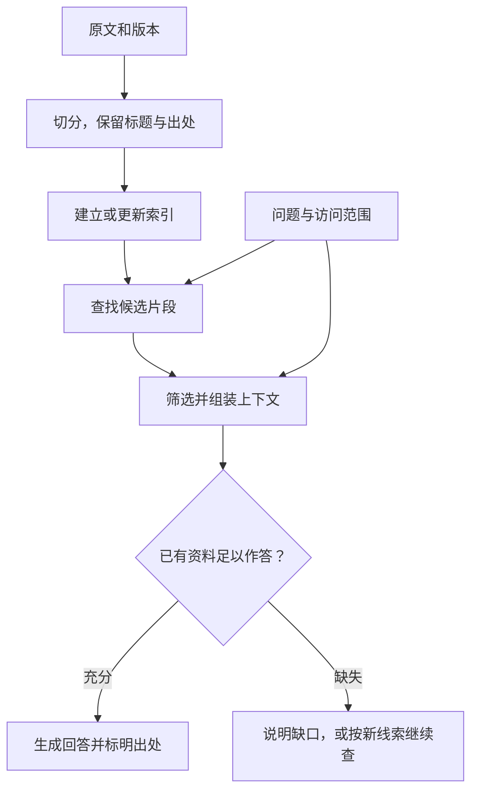

---
aliases:
  - 检索增强生成
  - Retrieval-Augmented Generation
---

# 检索增强生成（RAG）

## 概念

### 定义

<!-- 提示
**备选问题**：它是什么？
[第一性原理](thinking-principles.md)
优先借鉴wiki。
-->

**检索增强生成（Retrieval-Augmented Generation，RAG）**让模型在回答时查用外部资料。系统按当前问题检索原文，把结果交给生成模型，模型据此组织答案。==识别 RAG，先看检索结果是否进入了生成过程。== 结果用得对不对，要另外检验。[Lewis 等，第 2 节](https://arxiv.org/html/2005.11401v4#S2)

### 核心价值

<!-- 提示
**备选问题**：它针对的问题有哪些？问题难点在哪里？根因有哪些？提供了什么价值？
分析时，从问题的具体表现溯因推理，总结「特征/根因」。
成文时，首句直接点明它解决或缓解了什么具体问题，再说明问题为何产生、方法如何起效。
首句推荐示例：“LLM 的知识截止到训练时「特征/根因」，难以回答依赖新知识的请求「问题」，RAG 让 LLM 能查到最新资料「价值」。”
[矛盾论](thinking-principles.md)
-->

组织内部的知识和刚生效的修订，往往超出[[大语言模型]]在训练中学到的范围。把这些事实保存在文档库中，系统就能在每次作答时查阅适用版本。知识更新的关键随之变成两件可检查的事：原文是否已更新，系统能否检索到更新后的段落。[Lewis 等，第 4.5 节，更换索引实验](https://arxiv.org/html/2005.11401v4#S4.SS5)

外部原文也让回答可以核验。如果每项关键结论都指向具体段落，读者就能检查数值、时间和例外条件。一个链接只能定位来源；还要读到对应文字，才能判断它是否支持这项结论。[Claude 文档，引用](https://platform.claude.com/docs/en/build-with-claude/citations)

### 相似概念

<!-- 提示
**备选问题**：有哪些容易混淆的概念？如何区分？
推荐表格比较异同，无混淆概念skip。
按需自由定义对比字段，优先考虑候选字段：名称<必有>、说明<必有；一句话>、挑战<应对的问题>、核心机制、优点<必有>、缺点<必有>、场景<必有>、使用条件、代价、热度<star/热度>
-->

| 方法 | 做法与优势 | 适用条件与局限 |
| --- | --- | --- |
| 搜索 | 返回匹配的文档或段落，读者可直接核对原文 | 足以满足找文件、找出处的需求；综合多份材料要另做 |
| 全文输入 | 把指定材料完整交给模型，省去检索时漏选的风险 | 材料范围已知且放得进输入；读长文仍可能遗漏细节 |
| RAG | 按问题选材，模型只需读取相关部分 | 资料多、每题所需范围小时合适；漏检会让生成缺少依据 |
| [[微调与后训练\|微调]] | 用训练样本调整模型参数，让特定任务的表现更稳定 | 需要代表性样本；某条事实修订后，仍需要让系统获得新事实 |

微调和检索可以同时使用。原始 RAG 研究就用训练样本共同调整查询编码器和生成模型，同时从外部索引读取文档。[Lewis 等，第 2.4 节](https://arxiv.org/html/2005.11401v4#S2.SS4)

### Ask

**Ask A01**：一个系统用关键词找到原文，并依据原文生成回答。判断它是否属于 RAG，应看什么？

> [!faq]- 答案
> 看检索到的原文是否参与这次回答的生成。题中的系统按问题查原文，随后模型用原文作答，因此属于 RAG。只展示搜索结果，或答案生成后才补搜一个链接，都缺少这层依赖。

## 工作原理

<!-- 提示
通常先讲基本过程，再介绍关键组成；理解过程必须先认识结构时，可交换前两节。
图文各自补充信息，避免重复。具体瓶颈与改进方案放到“演进与瓶颈”。
-->

### 基本过程

<!-- 提示
**备选问题**：整个系统完成什么事情？从输入到输出经过哪些环节？各环节做什么、起什么作用，彼此如何衔接？
先概览整体过程，再逐项展开具体步骤；存在多级结构时，按层级分组说明。简单顺序用步骤，复杂交互用流程图。
[系统性思考](thinking-principles.md)
-->

文档问答有两条路径。资料更新时，系统把原文加工成可以搜索的片段。用户提问时，系统从可访问的片段里选出证据，连同问题一起交给模型。两条路径在**索引**相接，索引记录了按哪些线索能找到哪段原文。

图末的判断是一项作答要求，系统可以通过单独检查或生成指令实现。判断也可能出错，因此测试时要同时保留能回答和应当拒答的问题。[Joren 等，第 5.1 节](https://arxiv.org/html/2411.06037v2#S5.SS1)

### 关键组成

<!-- 提示
**备选问题**：有哪些关键要素？各自是什么、负责什么？它们如何组成系统，彼此如何依赖？需要哪些外部资源？
围绕主题识别关键要素，逐项介绍其名称、是什么、作用，各项的联系，按需补充有助理解的内容。
按信息关系选择列表、表格或分段，结构与依赖关系按需配图。
[系统性思考](thinking-principles.md)
-->

**知识源与索引。** 知识源保存可核对的原文。建索引时，片段要带上文档标识、位置和适用版本；表头、标题或上文决定片段含义时，也要保留这些联系。否则即使找到一句原话，也可能认错它描述的对象。追查过期答案时，沿这条路径逐项对照版本，找出最早出现旧文的位置。[Anthropic，片段丢失语境的原因](https://www.anthropic.com/research/contextual-retrieval)

**检索器与重排器。** 检索器从允许访问的范围里快速找出一批可能相关的片段，称为候选。重排器再把问题与各候选放在一起评分，让更贴题的片段优先进入输入。重排只能重新选择已有候选，能挽回排名靠后的证据，无法找回完全漏掉的原文。[Anthropic，重排](https://www.anthropic.com/research/contextual-retrieval)

**上下文与生成模型。** 上下文是模型本次实际读到的信息。系统把问题、所选原文、来源和作答要求放入有限的输入空间。排查回答错误时，应保存实际发给模型的文本，才能看见哪些限制条件在去重或截短时被删掉。可将每次召回的原文和来源与当次输入和回答关联保存。[阿里云百炼，建立评估基线](https://help.aliyun.com/zh/model-studio/rag-optimization/)

### 能力模型

<!-- 提示
**备选问题**：能力如何建模？潜在杠杆点在哪里？

1. **确定能力**：明确要解释的结果。
2. **建立模型**：从第一性原理出发，拆解影响能力的因子，讲清它们怎样影响结果、如何相互作用，以及由此能作出什么判断。按建模需要逐层拆解因子，可从理解原因、寻找干预点、判断效果等角度考虑是否继续细分，不追求穷尽。
3. **检验模型**：用事实与正反情形检验，区分已知关系与建模假设。
4. **识别杠杆**：根据模型，结合影响程度、可控性与代价，识别潜在干预点。

公式与因子使用中文名称，禁止字母代号。公式先讲整体含义，再逐层推导；随推导介绍因子的含义、作用与关系，按需用列表、表格或图示辅助。

[第一性原理](thinking-principles.md)
[系统性思考](thinking-principles.md)
[数学建模](thinking-principles.md)
[求证](thinking-principles.md)
-->

把“回答完整正确，且每项关键结论都有本次输入的有效原文支持”算作一次**有据作答成功**。在同一批测试题上，可以把成功率拆成两部分：

$$
\text{有据作答成功率}=\text{依据充分率}\times\text{充分时的作答成功率}
$$

第一项以全部题为分母，看有多少题的最终输入包含一整组有效依据。第二项只以这些依据充分的题为分母，看模型有多少次读懂并答对。两个比例相乘是按条件计数，无需假设检索与生成互相独立。若没有一道题获得充分依据，第二项记为无法估计。

在证据只沿“授权原文 → 候选 → 最终输入”流转的单轮系统中，逐题查找第一次缺证的位置，就能区分**原文缺失、检索漏选、组装丢失**。模型凭记忆猜对和资料不足时合理拒答，均单独统计。上述公式是本文的诊断口径；研究依据是对上下文充分性和作答表现的分开测量。[Joren 等，第 3—4 节](https://arxiv.org/html/2411.06037v2#S3)

### 关键机制

<!-- 提示
**备选问题**：背后的核心原理是什么？有哪些关键机制？
结合能力模型，深入解释关键因素与作用关系背后的机制，按需介绍相关技术、原理或论文。
[第一性原理](thinking-principles.md)
[求证](thinking-principles.md)
没有不硬凑。
涉及论文提出的机制时，引用原文中解释该机制的段落或公式。
-->

检索分数估计的是片段和问题有多匹配。生成模型需要解决的是另一件事：哪些事实合起来，足以推出答案？只找到主体条款，遗漏限定它的例外条款，仍会得到分数很高、依据有缺口的输入。选材时应检查每个必要事实是否至少有一处支持。[Joren 等，第 3.1 节](https://arxiv.org/html/2411.06037v2#S3.SS1)

原始论文还给出了一种更紧密的结合方式。对同一个问题，模型分别在不同候选文档下计算答案的生成概率，再按检索概率加权。其序列模型对整条答案加权，词元模型则在每一步预测下一个文本单位时加权。常见的文档问答可以直接把多个片段拼入一次输入，沿用同一思想而省去上述概率计算。[Lewis 等，第 2.1 节两种模型的公式](https://arxiv.org/html/2005.11401v4#S2.SS1)

### Ask

**Ask A02**：原文已经修订，回答却仍引用旧条款。你会沿着哪条数据路径追查旧内容的来源？

> [!faq]- 答案
> 先确认该问题适用的日期和版本，再沿授权原文、索引片段、候选、最终输入、答案引用逐项比对版本及段落标识。原文已更新而索引仍旧，查更新流程；候选里新旧并存，查版本筛选；输入只有新版而回答仍用旧文，查生成及引用映射。以最先出现不一致的位置决定改动。

**Ask B01**：扩大输入后，有完整证据的题更多，有据作答成功率却下降了。如何用能力模型解释？

> [!faq]- 答案
> 有据作答成功率等于依据充分率乘以充分时的作答成功率。前一项上升而乘积下降，说明后一项下降且抵消了收益。先在扩容前后依据都充分的同一批题上，只改变干扰段落或证据位置再测；新增的可答题也可能本来就更难，不能仅凭汇总比例断定模型受到了干扰。

## 分类

<!-- 提示
**备选问题**：有哪些常用分类维度？为什么这样分？各维度下有哪些类型？类型之间有哪些重要差异与联系？
明确分类对象，选择有助于理解主题的分类维度，说明划分依据并介绍主要类型。
多个类型用列表或表格展示，先讲核心特点，突出差异；按需补充新机制、特点或适用条件，避免重复前文。
[系统性思考](thinking-principles.md)
-->

选择检索方案时，先决定用什么线索找，再决定要找几轮。这两个选择可以独立组合。

| 匹配方式 | 靠什么找到原文 | 何时有用 |
| --- | --- | --- |
| 关键词检索 | 根据查询词在片段中的出现情况及其区分度排序 | 编号、专名或术语是主要线索；精确约束还需核对字段 |
| 向量检索 | 用嵌入模型把问题和片段编码成可比较的一组数，按相似度排序 | 提问和原文用词不同、语义接近；相近编号仍可能混淆 |
| 混合检索 | 分别取得词项和语义匹配的结果，合并排名后再筛选 | 两类线索都有价值；需要测试合并后是否挤掉关键片段 |

词语匹配和语义匹配均可用于单轮或多轮流程。**单轮检索**按原问题找一次。**多轮检索**用已查明的中间事实构造下一次查询，适用于提问时尚不知道下一份证据该按什么找的任务。[Anthropic，检索方法](https://www.anthropic.com/research/contextual-retrieval) · [Trivedi 等，多步问题](https://aclanthology.org/2023.acl-long.557/)

### Ask

**Ask A03**：问题中既有必须精确匹配的编号，又有与原文不同的措辞。你会怎样选择检索方法？

> [!faq]- 答案
> 保留原编号并核对确切值；有可靠编号字段时，先用它限定范围。再用关键词找原词、用向量找不同措辞，合并后检查正文是否支持结论。固定候选数，与单一路径比较，重点看找齐编号对应的完整依据增加了几题。

## 演进与瓶颈

<!-- 提示
围绕理解现有设计所需的关键变化与限制展开，按主题取舍。
用能力模型解释变化与限制，以事实检验模型。
-->

### 关键演进

<!-- 提示
**备选问题**：有哪些关键演进？改变了什么？为什么重要？
- **筛选**：依据带来的实质变化及其影响程度识别关键演进，参考领域共识；不硬凑。
- **讲解**：讲清关键变化及其意义，按理解需要展开。
- **展示**：按内容关系选用时间线、演进图、列表或表格，按需分段展开。
[矛盾演化](thinking-principles.md)
-->

| 代表工作 | 改变了什么 | 解决了哪个设计问题 |
| --- | --- | --- |
| Lewis 等，2020 | 训练时把查询编码器与生成模型连起来，知识仍可放在外部索引 | 知识密集型任务可以同时利用模型参数和可替换的文档 |
| Ram 等，2023 | 保持语言模型不变，把检索文本接到模型输入中 | 仅能调用已有模型时，仍可在应用侧引入外部知识 |
| Trivedi 等，2023 | 交替利用已有材料推导中间结果，再据此查询 | 后续查询的线索可以在解题过程中逐步形成 |

这些工作分别改变训练、接入和查询时机。任务只需一段明确原文时，增加查询轮数通常只是多付一次等待成本。[Lewis 等，第 2 节](https://arxiv.org/html/2005.11401v4#S2) · [Ram 等，上下文检索增强语言模型](https://aclanthology.org/2023.tacl-1.75/) · [Trivedi 等，第 2 节](https://aclanthology.org/2023.acl-long.557/)

### 当前瓶颈

<!-- 提示
**备选问题**：哪些因素仍限制效果或发展？根因是什么？已有方案如何改善？效果、代价和适用条件有何差异？
> 对应介绍瓶颈与方案，说明改进与局限，适用条件与验证情况。
[矛盾论](thinking-principles.md)
[求证](thinking-principles.md)
-->

**找得全与读得准之间有取舍。** 候选少时，关键事实可能排在截取范围外。扩大候选后再重排，可以先广泛查找，再控制交给模型的材料。如果全文都塞入输入，相似但适用条件不同的段落会增加辨别负担。在多文档问答实验中，仅改变证据位置就影响了部分模型的正确率。比较扩容前后的效果时，先看两次都已找齐证据的同一批题。新增的可答题可能更难，会改变总体比例。[Anthropic，重排实验](https://www.anthropic.com/research/contextual-retrieval) · [Liu 等，第 2 节](https://arxiv.org/html/2307.03172v3#S2)

**继续查找需要明确的缺口。** 若已知缺哪项事实，并且刚获得的新线索能帮助定位它，可以再查一轮。若授权资料本身缺失、来源相互矛盾且无法判定适用版本，应说明能确定的部分及缺少的依据。给多轮流程设置轮数或时间上限，可以限制重复查找的耗时。[Trivedi 等，多步检索](https://aclanthology.org/2023.acl-long.557/) · [Joren 等，选择性作答](https://arxiv.org/html/2411.06037v2#S5)

### Ask

**Ask A04**：什么情况下，继续增加单轮检索的候选数量仍难补齐依据，需要改用多轮检索？

> [!faq]- 答案
> 当下一步要查的对象只能从第一批材料中得知时，需要用中间事实形成新查询。扩大旧查询的候选数仍沿用旧线索。若已知线索正确、证据只是排名偏后，先比较扩大候选并重排的效果。多轮的额外成本应由新增的有据正确答案来衡量。

## 使用场景

<!-- 提示
**备选问题**：哪些任务适合用它？为什么适合？什么情况下更适合其他方案？
从典型场景溯因，抽象出可举一反三的关键条件；用正反情形检验，并与前文价值、机制及能力模型交叉核对。
[第一性原理](thinking-principles.md)
[求证](thinking-principles.md)
-->

判断一个任务是否适合 RAG，可以先问：**一组按问题找到的原文，足以支撑用户要的结论吗？** 面向大量、持续更新的业务文件做定点问答时，通常只需读其中几段，却要说明这些段落如何共同支持答案。这时按题检索既减少阅读量，也能保留出处。

如果用户已指定少量材料，任务又要求通读全文，直接输入通常更容易保证覆盖。若要求“列出全部”或“证明没有遗漏”，检索排名只能说明返回了哪些结果。此时应先界定集合并逐项遍历或做全量查询，再让模型整理结果。这条选择原则来自任务的覆盖要求，具体成本仍需用自己的材料测量。[Anthropic，全文输入与大型知识库](https://www.anthropic.com/research/contextual-retrieval)

### Ask

**Ask B02**：要列出所有受一次制度修订影响的文件，怎样判断按相关度取前几段能否满足要求？

> [!faq]- 答案
> 先确定“所有文件”的范围，并检查每份文件是否都被核查过。按相关度取前几段只能给出已找到的文件，排名之外仍可能有受影响项。可以遍历约定范围内的全部文件、逐份记录判断依据，再用生成模型汇总。

## 评估与干预

### 指标与测评

<!-- 提示
**备选问题**：如何衡量整体能力与关键因子的表现？怎样测？结果能说明什么？
根据能力模型选择关键指标，配对介绍指标含义、测评方法与结果解读，按需用表格展示。
说明指标口径；用过程指标推断整体能力时，指出可能的误判。
[数学建模](thinking-principles.md)
[求证](thinking-principles.md)
-->

先选一组代表真实需求的问题，固定文档版本和访问范围。对能回答的题，标出必要事实、限制条件，以及能支持它们的一组或多组原文。对资料不足的题，标出缺口及应有的回答边界。这样，同一道题就能沿着整个流程核查。[Joren 等，第 3—5 节](https://arxiv.org/html/2411.06037v2#S3)

| 要测什么 | 分母 | 成功判据 |
| --- | --- | --- |
| 候选找齐率 | 授权资料足以回答的题 | 候选中至少有一组完整依据 |
| 输入保留率 | 候选已找齐的题 | 最终输入仍含一组完整依据 |
| 充分时的作答成功率 | 最终输入充分的题 | 回答完整、正确，各关键结论有原文支持 |
| 有据作答成功率 | 全部测试题 | 最终输入充分且回答通过上述作答标准 |
| 合理拒答率 | 授权资料不足、按要求应拒答的题 | 指出无法确定的部分，并避免给出无依据的确定结论 |

另记可答题被误拒的比例，防止系统靠少回答提高表面正确率。任务要求引用时，将答案拆成可核实的陈述，逐条检查有没有引用、所引位置能不能支撑该陈述。固定可答题与不可答题的构成，再按误答和误拒各自的业务代价比较版本。

### 干预与验证

<!-- 提示
**备选问题**：潜在杠杆如何转化为具体干预？怎样验证效果？收益是否值得代价？
结合测评结果，说明哪里值得先改、为什么，以及怎样验证。
明确基线与对照条件，验证整体效果，关注代价及对其他因素的影响。
[系统性思考](thinking-principles.md)
[求证](thinking-principles.md)
-->

1. **找出证据最先丢失的位置。** 对每道错题依次查看授权原文、检索候选和最终输入。库中缺事实就补资料；候选漏选就改切分或匹配；候选齐全但输入不全就改筛选。记录各类错题数，据此估算哪项改动能帮助更多问题。
2. **用人工选齐的原文做对照。** 在同一批可答题上固定模型、问题和作答指令，只替换它看到的资料。若给足依据仍答错，先复核题意与评分标准，再检查模型是否误用了条款。换成完整原文后答对，说明输入值得优先调查。替换同时改变了内容、长度和顺序，要锁定原因，可分别补一条依据、去一段干扰或只改排列再测。[Liu 等，证据位置对照](https://arxiv.org/html/2307.03172v3#S2)
3. **回到整套系统复测。** 用同一评分标准比较旧版和改版，记录救回几题、新错几题、合理拒答与误拒怎样变化，再比较每题费用和响应时间。保留一组未用于调参的题作最后验证，避免把反复修改同一道错题当成普遍改善。

### Ask

**Ask A05**：更换检索方法后，更多问题命中了证据，答案正确率却没提高。怎样用人工选定的完整证据检验瓶颈是否仍在检索环节？

> [!faq]- 答案
> 对同一批可答错题固定模型、问题和作答要求，分别输入实际检索结果与人工选齐的原文。人工组答对，再看候选中是否已经找齐：候选缺证据就查检索，候选齐全而最终输入缺失就查筛选。两处都齐全，再分别控制干扰内容与顺序。人工组仍答错时，先核对题意和标注，再检查模型是否误用了依据。

**Ask B03**：提高作答所需的证据门槛后，系统在已回答的问题上更准确了。如何判断这次调整是否值得保留？

> [!faq]- 答案
> 固定测试题和资料版本，分别统计资料不足时的无据作答、资料充分时的误拒，以及全部题中的有据正确回答数。把减少的无据回答与新增的误拒逐题对照，按实际任务对两种错误的代价判断。只看已回答题，会漏掉被新门槛挡住的可答题。
